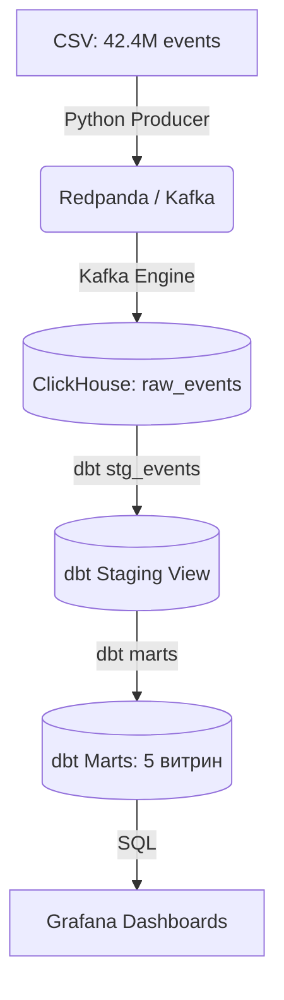

# 🛒 ShopStream: Real-time Analytics Platform

**ShopStream** — это end-to-end платформа аналитики интернет-магазина, обрабатывающая поток событий в режиме, близком к реальному времени. Проект демонстрирует современный стек данных: от сбора сырых событий до построения интерактивных BI-дашбордов.

---

## 📑 Оглавление
1. [Описание решения](#-описание-решения)
2. [Архитектура данных](#-архитектура-данных)
3. [Технологический стек](#-технологический-стек)
4. [Ключевые результаты](#-ключевые-результаты)
5. [Шаги развертывания](#-шаги-развертывания)
6. [Changelog](#-changelog)

---

## 📖 Описание решения

**Бизнес-проблема:** Классические реляционные СУБД (PostgreSQL, MySQL) не справляются с аналитикой на десятках миллионов строк в реальном времени — запросы агрегации занимают минуты, а дашборды отстают от реальности.

**Наше решение:** Гибридная архитектура (Lambda-like), где:
1. **Слой скорости (Real-time):** События из Kafka стекаются в ClickHouse через Kafka Engine и Materialized View. Данные доступны для запросов за секунды.
2. **Слой трансформаций:** Инструмент **dbt** строит очищенные слои (staging) и бизнес-витрины (marts) на основе сырых данных.
3. **Визуализация:** **Grafana** подключается напрямую к витринам ClickHouse, обеспечивая мгновенную загрузку графиков.

**Объём данных:** В рамках проекта обработан открытый датасет **REES46** — 42.4 млн событий e-commerce за октябрь 2019 года.

---

## 🏗 Архитектура данных



**Слои данных в ClickHouse:**
*   `shop.raw_events` — сырые события (движок MergeTree).
*   `shop_staging.stg_events` — очищенные данные (View).
*   `shop_marts.*` — 5 материализованных витрин (Table) для BI.

---

## 🛠 Технологический стек

*   **Хранилище:** ClickHouse 24.10
*   **Брокер сообщений:** Redpanda (Kafka-совместимый)
*   **Трансформации:** dbt-core + dbt-clickhouse
*   **Визуализация:** Grafana
*   **Оркестрация:** Docker Compose
*   **Язык:** Python 3 (kafka-python, Faker)

---

## 📈 Ключевые результаты и инсайты

*   **Обработано данных:** 42 470 945 событий (3 типа: view, cart, purchase).
*   **GMV за октябрь 2019:** $230M.
*   **Топ-бренд:** Apple ($111M, несмотря на меньшее число заказов, чем у Samsung — за счёт высокого среднего чека).
*   **Воронка продаж:** Конверсия из просмотра в покупку — 1.6–2.1%.
*   **RFM-сегментация:** Самая ценная группа — `cant_lose` (54% всей выручки, $105M).
*   **Retention:** На первой неделе возвращается 15.2% пользователей, на четвёртой — 9.35%.

---

## 🚀 Шаги развертывания

### Предварительные требования
*   Docker Desktop (с WSL2 для Windows)
*   Python 3.10+ (в проекте использовался 3.14)
*   Git Bash или Linux-терминал

### 1. Клонирование репозитория и установка зависимостей
```bash
git clone <твой_url_репозитория>
cd shopstream

# Создаём виртуальное окружение и ставим зависимости
python -m venv .venv
source .venv/Scripts/activate  # Для Windows (Git Bash)
# source .venv/bin/activate    # Для Linux/macOS

pip install -r requirements.txt
```

### 2. Запуск инфраструктуры (Docker)
Проект использует **именованные тома** (named volumes) вместо bind-mount, чтобы избежать проблем с правами доступа на Windows.

```bash
docker compose -f infra/docker-compose.yml up -d
```
*Проверка:* `docker compose -f infra/docker-compose.yml ps` — все контейнеры (clickhouse, redpanda, grafana) должны быть `Up (healthy)`.

### 3. Инициализация ClickHouse
Создаём базу данных, таблицу `raw_events`, Kafka Engine и Materialized View.

```bash
docker compose -f infra/docker-compose.yml exec -T clickhouse \
    clickhouse-client --multiquery < clickhouse/init/01_schema.sql
```

### 4. Загрузка данных (Replay)
Запускаем Python-скрипт, который читает CSV и отправляет события в Kafka. 
*(Файл `2019-Oct.csv` нужно предварительно скачать с Kaggle и положить в `data/rees46/`)*.

```bash
# Тестовый прогон на 1000 строк
python producer/replay.py --file data/rees46/2019-Oct.csv --limit 1000

# Полный прогон (42.4M строк)
python producer/replay.py --file data/rees46/2019-Oct.csv --rate 5000
```

### 5. Настройка и запуск dbt
Для работы dbt требуется профиль подключения. Создайте файл `~/.dbt/profiles.yml`:

```yaml
dbt_shop:
  target: dev
  outputs:
    dev:
      type: clickhouse
      schema: shop
      host: localhost
      port: 8123
      user: default
      password: ''
      secure: false
      threads: 4
```

Запуск моделей и тестов:

```bash
cd dbt_shop
dbt debug   # Проверка подключения
dbt build   # Запуск моделей и тестов (PASS=32)
dbt docs generate && dbt docs serve --port 8085  # Генерация документации
```

### 6. Настройка Grafana
1. Открой `http://localhost:3000` (admin/admin).
2. Перейди в **Connections -> Data sources -> Add data source -> ClickHouse**.
3. Настройки: `Server address: clickhouse`, `Port: 8123`, `Protocol: HTTP`, `User: default`.
4. Нажми **Save & test** (должно появиться "Data source is working").
5. Импортируй дашборд из `grafana/dashboards/shopstream_overview.json` (Dashboards -> New -> Import).

---

## 📝 Changelog

Все значимые изменения в проекте документированы в этом файле.

### [1.3.0] - 2026-10-23
#### Добавлено
*   Настроен datasource ClickHouse в Grafana.
*   Создан интерактивный дашборд `ShopStream Overview`.
*   Экспортирован JSON-дашборд в репозиторий.
*   Написана подробная документация.

### [1.2.0] - 2026-10-23
#### Добавлено
*   Создан dbt-проект (адаптер `dbt-clickhouse`).
*   Разработаны 5 аналитических витрин (marts).
*   Написаны 26 data-тестов.

### [1.1.0] - 2026-10-23
#### Добавлено
*   Загружен полный датасет REES46 (42.4M строк).
*   Написан Python-продюсер с поддержкой ограничения скорости.

### [1.0.1] - 2026-10-22
#### Исправлено
*   Ошибка `Permission denied` из-за bind-mount на Windows (переход на Docker Volumes).
*   Materialized View теряли связь с Kafka Engine.

### [1.0.0] - 2026-10-22
#### Добавлено
*   Настройка инфраструктуры (ClickHouse, Redpanda, Grafana).
*   Проверен сквозной пайплайн на тестовых событиях.
